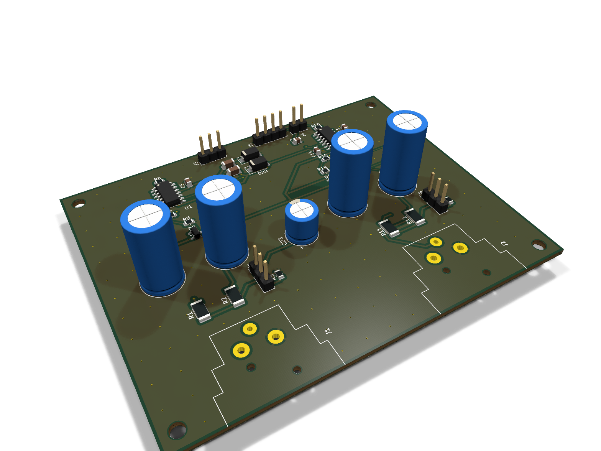
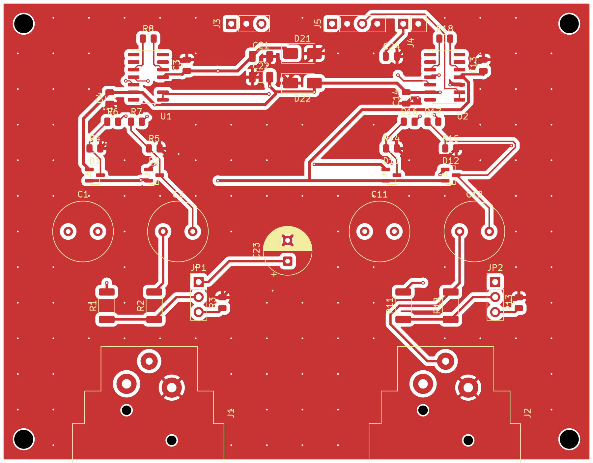
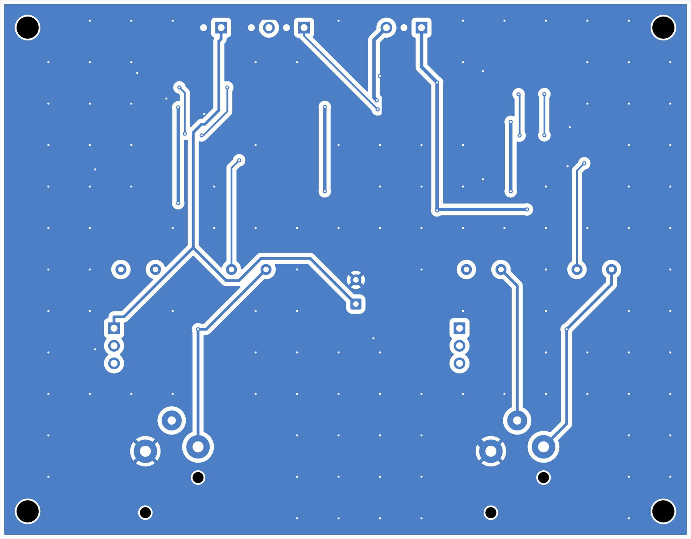

# 2-channel phantom-powered mic preamp — KiCad sample

Owner: Hai (GitHub `haiha-ux`). Test/portfolio project, not client work.

KiCad 10.0.6 project: schematic + 2-layer 100 × 78 mm PCB with ERC/DRC reports, fab outputs
and renders. **The audio signal path is routed by hand; only power, phantom feed and
ground are autorouted.** Every file is generated by the scripts in `tools/`, so the whole
design can be rebuilt from scratch.



| Top copper | Bottom copper |
|---|---|
|  |  |

Schematic: [mic_preamp_2ch_schematic.pdf](mic_preamp_2ch_schematic.pdf)

## What is on the board

Per channel (×2):

| Block | Parts | Source |
|---|---|---|
| Input | Neutrik NC3FAH1 female XLR, horizontal (pin 1 GND, 2 hot, 3 cold) | — |
| Phantom feed | Per leg, **2 × 3.40 kΩ 0.1 % thin film 1206 in series (6.80 kΩ)**; 3-pin jumper ON (1-2 → +48 V) / OFF (2-3 → 47 kΩ to GND) | INA163 datasheet Fig. 5 (R1, R2, R3) |
| DC block | 2 × 47 µF 63 V **bi-polar** electrolytic | Fig. 5 note (1): non-polar required when phantom can be switched off |
| Input protection | BAV99 dual diode per leg, clamping to ±15 V | Fig. 5 text ("four diodes to the supplies") |
| Bias return | 2 × 2.2 kΩ **0.1 %** to GND | Fig. 5 (R4, R5) |
| Series resistor | 10 Ω 0.1 % per leg, between the clamp node and the IC input | design choice, see below |
| Preamp | TI **INA163UA** (SOIC-14), G = 1 + 6000/RG, RG = 60.4 Ω → G = 100.3 (40.0 dB) | gain equation and table, datasheet p. 6 |
| Decoupling | 100 nF X7R on each rail, right at the IC pins | Fig. 1 ("0.1 µF near the device pins") |

Shared: ±15 V header J3 with 10 µF on each rail and SMAJ16A TVS rail clamps (D21/D22);
+48 V header J4 with 47 µF/100 V + 100 nF; line-out header J5 (OUT1/GND/OUT2/GND); 4 × M3 holes.

Datasheet used: TI SBOS177D (INA163). Pin-out from p. 2, gain from p. 6, application
circuit from Fig. 5 on p. 8. **Each figure was rendered and compared to the schematic node
by node** (see the v2 correction below for why).

## Layout (v2)

- **IC rotated 90°.** Input pins 4/5 face the XLR; output pins 8/9 face the connectors on
  the far edge. The output never runs near the input, as the datasheet asks on p. 6.
- **Hot and cold legs are routed by hand as a symmetric pair.**
  - The legs run 11.5 mm apart, each straight through its DC-block capacitor and 10 Ω
    resistor.
  - Clamp diodes and bias resistors branch off to the outside of each leg.
  - The two legs converge onto pins 4/5 at 45°.
  - Measured copper length per leg after the capacitors: IN±_PROT 16.30 / 16.30 mm and
    IN± 11.72 / 11.72 mm. Each leg has 0 vias.
  - Between the XLR and the capacitors the lengths differ: hot 24.8 mm, cold 19.5 mm,
    including the phantom stubs. The XLR pin order is mirrored relative to the IC pin
    order, so the legs must cross once. They cross here using the through-hole pads (hot on
    B.Cu), which needs no via.
- **RG loop.** R8/R18 sit next to the IC end, with a 9.1 mm loop (RG1A/RG1B).
- **Decoupling.** Caps are placed on the V+ and V− pins, with a GND via at each cap.
  The Ref pin (pin 10) goes through a via straight into the GND pour, with no thermal
  relief. Datasheet p. 6 says even a few ohms in series with Ref hurts CMRR.
- **What is autorouted (Freerouting 2.4.1).** The ±15 V rails, +48 V/phantom feed and
  GND. There are 98 hand-routed tracks/vias; they are locked and exported as `fix`, so the
  router cannot move them.
- **Ground.** GND is poured on both layers, with 103 stitching vias.

## Outputs

| File | What |
|---|---|
| `mic_preamp_2ch.kicad_pro/.kicad_sch/.kicad_pcb/.kicad_dru` | KiCad project, including custom DRC rules |
| `lib/preamp.kicad_sym` | INA163UA symbol (not in the stock KiCad library) |
| `mic_preamp_2ch_schematic.pdf` | schematic, A3 |
| `reports/erc_report.rpt/.json` | raw `kicad-cli sch erc --severity-all` output |
| `reports/drc_report.rpt/.json` | raw `kicad-cli pcb drc --severity-all --schematic-parity` output |
| `fab/gerber/` + `fab/mic_preamp_2ch-gerber.zip` | Gerber X2 (9 layers), Excellon PTH/NPTH, drill maps, job file |
| `fab/mic_preamp_2ch-BOM.csv` | BOM with manufacturer, MPN, LCSC number |
| `fab/mic_preamp_2ch-CPL.csv` | pick-and-place (SMD only) |
| `renders/` | 3D top / bottom / iso, plus 2D copper views of top and bottom |

## Check results (final board)

- **ERC: 0 errors, 0 warnings.**
- **DRC: 0 errors, 0 unconnected, 0 schematic-parity issues.** There are 4 warnings, all
  waived (see below).
- **Netlist check:** the `kicad-cli` netlist is compared pin-by-pin with the intended net
  table (`tools/check_netlist.py`). It matches 100 %. The check has a built-in sabotage
  case: moving one pin to another net must make it fail.
- **Was the 48 V clearance rule actually applied?** On a copy of the board the rule was
  raised from 0.6 mm to 5 mm, and DRC reported 301 "P48 creepage" violations. So the rule
  really matches the 48 V nets; it is not passing trivially.
- **Drill file:** the hits in the Excellon files were counted (167 PTH + 8 NPTH) and match
  the pads and vias on the board.
- **Independently re-verified with KiCad 10.0.8 (ERC 0, DRC 0 errors).** A separate reviewer
  re-ran the checks on another machine with the official libraries. Results: 0
  unconnected, 0 parity issues, the same 4 XLR silk warnings, and no footprint differs from
  the library.

### Waived DRC items

| Item | Count | Reason |
|---|---|---|
| `silk_edge_clearance`, J1/J2 | 4 | The NC3FAH1 front flange sits in front of the panel line, which the footprint marks on Dwgs.User at x = 12.7 mm. The board edge is placed on that panel line, so the flange outline overhangs the board by design. |

### Design-rule decisions (they change what "0 errors" means)

- **Board minimum track width is 0.15 mm** (KiCad default is 0.2 mm). This allows the
  autorouter to narrow tracks at SOIC pads. JLCPCB/PCBWay handle 0.1 mm.
- **±15 V tracks are ≥ 0.4 mm.** Inside the IC and decoupling-cap courtyards they may
  narrow to 0.3 mm. Those are local stubs carrying a few mA. This is the
  `Power neck-down` rule in the `.kicad_dru` file.
- **All nets that can carry 48 V have ≥ 0.6 mm clearance.** That is +48V, PH1/2, P1H/P1C/P2H/P2C,
  XLRx_HOT, XLRx_COLD and P48OFF1/2. The value is IPC-2221B table 6-1, column B2
  (external, uncoated, 31–150 V). Solder mask was not counted as a coating, which is the
  conservative choice.
- **GND pads of J3/J4/J5 are solid** (no thermal relief). `tools/build_pcb.py::fix_starved`
  applies the same treatment to any GND pad that DRC reports as `starved_thermal`;
  none on the final board.

## v2 changes (after independent review of v1, commit efc1e58)

1. **Correction: v1 had 47 Ω in series with each input and the README said it came from
   datasheet Fig. 2. That was wrong.**
   - Fig. 2 shows 47 Ω **in parallel with** 1.2 µH; I had read only the extracted text of
     the page, not the figure.
   - 2 × 47 Ω in series adds √(4kT·94 Ω) ≈ 1.25 nV/√Hz, which is more than the INA163's
     own 1 nV/√Hz.
   - v2 uses 10 Ω 0.1 % per leg. It still shares fault current with the IC's internal
     input clamps (abs-max 10 mA) and adds 0.57 nV/√Hz for both legs. That gives a total
     of about 1.15 nV/√Hz, or +1.2 dB of noise.
2. **Matched parts for CMRR.**
   - The phantom feed resistors are now 0.1 % thin film. A 6.81 kΩ part of that grade
     exists only in 1206 (0.25 W), but a shorted mic line puts 0.34 W into one leg. So
     each leg is 2 × 3.40 kΩ in series: 6.80 kΩ, 0.17 W per part.
   - The bias resistors are now 0.1 % too.
3. **The signal path is routed by hand** (see Layout). In v1 everything was autorouted:
   the hot/cold legs were not paired, and there was a long detour.

Not done yet from the review, kept as known limitations:

- **EMI filtering and AES48 grounding at the XLR.** No small caps from pins 2/3 to the
  shell, and the shell is not taken to a separate chassis point. With the NC3FAH1 the
  shell is tied to pin 1 inside the connector. Separating them needs the NC3FAH2, which
  has its own ground contact.
- **The DC servo of Fig. 5 (OPA134) is not fitted, so the output is DC-coupled.**
  Estimated DC offset at G = 100, from datasheet values: typically about 7 mV (Vos) plus
  22 mV (Ios × 2.2 kΩ); worst case about 30 mV plus 220 mV. **The next stage must be
  AC-coupled.**

## Deviations from the brief / datasheet — please review

1. **Phantom "switch" is a 3-pin jumper header (Molex 22-28-4030, 500 V) plus a shunt,
   not a slide switch.** Every small PCB slide switch checked has a DC rating below the
   48 V ±4 V of IEC 61938:
   - C&K OS102011: 12 VDC
   - Würth 450301014042: 12 VDC
   - E-Switch EG1271: 30 V
   - E-Switch EG1224: 15 VDC
   - C&K 7101 toggle: 28 VDC

   The header doubles as the connection point for a panel-mount switch. Its OFF position
   discharges the node through 47 kΩ, the same as R3 in datasheet Fig. 5.
2. **Gain is fixed at 40 dB** (the brief said "gain set by one resistor"). Change R8/R18
   using the RG table on p. 6.
3. **The C1/C2 type (Nichicon UVP1J470MPD) is marked "Not For New Designs" on DigiKey.**
   Cornell Dubilier 476BPS063M (active) is listed as the alternative. Neither is stocked at
   LCSC, so the board is not fully JLC-assemblable as is.
4. **BAV99 is used instead of 1N4148**, with the same function in a smaller package
   (Nexperia BAV99: 100 V, 4 A surge per the LCSC listing).

## Things I am not sure about

- **XLR footprint.** I used the stock KiCad `Jack_XLR_Neutrik_NC3FAH1_Horizontal`. The
  Neutrik/LCSC drawing download was blocked, so I did **not** check its hole sizes and
  peg positions against the manufacturer drawing myself. There is also no 3D model for it
  in the KiCad library.
- **P48 hot-plug.** A shorted XLR line dumps the 48 V charge of C1/C2 through the BAV99
  diodes into the rails. I added the SMAJ16A rail clamps for that, but **there is no surge
  simulation or test**. The INA163 datasheet does not cover this case.
- **Creepage value.** I chose the conservative 0.6 mm. If solder mask is counted as a
  coating (IPC-2221B A6/B4), about 0.13 mm would be enough.
- **Ground split by the rails and OUT1.** The autorouted ±15 V rails and the OUT1 track run
  partly on B.Cu, under the channel-1 input area. They cut the bottom GND pour into a long
  slot (reviewer note). The F.Cu pour and the stitching vias carry the return current, but
  this has not been analysed. **Planned for v3:** move these tracks to the board edge or
  route them tighter, switch to the NC3FAH2 connector and add EMI filtering at the XLR.
- **Footprint height for C1/C2.** The bi-polar caps use `C_Radial_D10.0mm_H20.0mm_P5.00mm`;
  the real part is 17.5 mm tall. The 2D land pattern is the same; only the 3D height is off.
- **No SPICE or noise simulation.** Gain, noise and offset come from the datasheet
  equations only.

## Tool chain and how to rebuild

- KiCad 10.0.6. The schematic is written only through the Konnect MCP server
  (`tools/kcall.py` drives it over stdio); the `.kicad_sch` file is never edited as text.
- The PCB is built with KiCad's own `pcbnew` Python API, including the hand-routed
  signal paths.
- Routing of the rest: Freerouting 2.4.1 on Temurin JRE 25. The native `freerouting-cli`
  2.5.0 crashed with a GraalVM serialization error.
- Parts and MPNs come from the JLCPCB/LCSC parts database (local copy), plus DigiKey
  lookups for the bi-polar caps and the switch ratings.

To rebuild:

```bash
python tools/build_schematic.py      # move the old .kicad_sch out of the way first
python tools/check_netlist.py
"C:/Program Files/KiCad/10.0/bin/python.exe" tools/build_pcb.py all   # with KiCad closed
bash tools/export_outputs.sh
```

